<div align="center">

# 🎛️ Dashboard-Style

**Calm, themeable admin dashboards in the Material 3 / Google console style.**<br>
White panels on a tinted backdrop, hairlines instead of shadows, pill-shaped actions and motion that feels right.

[](https://saschazesiger.github.io/Dashboard-Style/)


[🚀 Live tour](https://saschazesiger.github.io/Dashboard-Style/) ·
[🖥️ Reference app](https://saschazesiger.github.io/Dashboard-Style/example/) ·
[🧩 Styleguide](https://saschazesiger.github.io/Dashboard-Style/styleguide/index.html) ·
[🎬 Motion Lab](https://saschazesiger.github.io/Dashboard-Style/styleguide/motion.html) ·
[📚 Docs](#-documentation)

<a href="https://saschazesiger.github.io/Dashboard-Style/"></a>

</div>

## ✨ Why Dashboard-Style?

| | |
|---|---|
| 🪶 **Plain CSS, tiny JS** | One stylesheet and one optional, dependency-free script. No framework, no bundler, no build step. |
| 🎨 **Themeable from one file** | Every colour, radius, font and shadow is a `--ds-*` token. A project theme overrides tokens; it never touches components. |
| ♿ **Accessible by default** | WCAG AA text contrast, a focus ring that is there from the first frame, forced colours (Windows contrast themes), status never by colour alone. |
| 🌊 **Motion that feels right** | One spring for everything that floats, ripples from your pointer, overlays that turn around mid-way, rows that glide when data changes. |
| 🧳 **Embeddable** | Tokens live on `.ds-theme`, not `:root`, and every rule sits in `@layer ds.*`, so the system runs inside someone else's page and the page's own CSS always wins. |
| 🔒 **Safe to vendor** | A checksummed copy of `dist/` in your project, updated by a nightly workflow. |

## 👀 See it in action

> 💡 Everything below is live on the [**tour page**](https://saschazesiger.github.io/Dashboard-Style/). Switch the top bar to
> **Slow motion** there to watch every animation at a fifth of its speed.

**Overlays** open from where you pressed and close back there: a side sheet that steps between records, a dialog that
grows from its button.

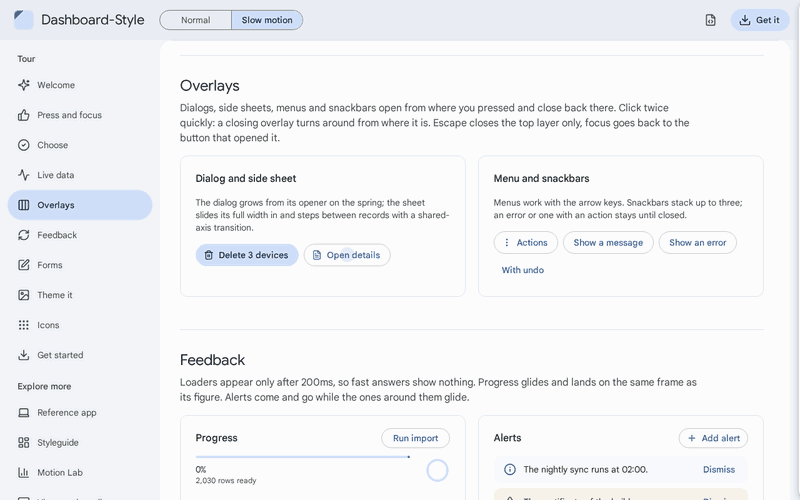

**Live data** glides: tiles count on from what they show, sorted rows travel to their new place, status chips fade
to their new colour.

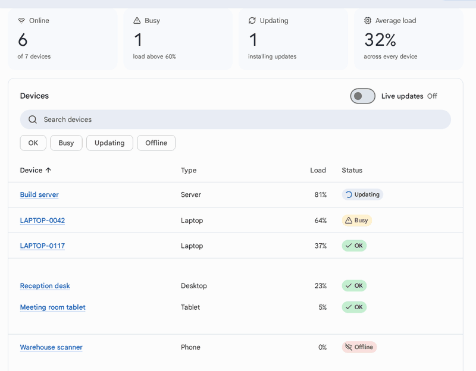

**One theme file** restyles everything: accent, shape and density are just tokens.

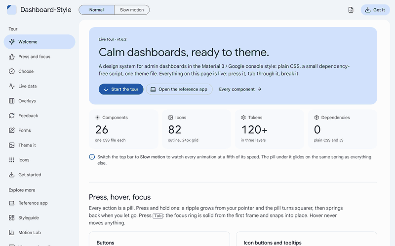

<table>
<tr>
<td width="50%"><a href="https://saschazesiger.github.io/Dashboard-Style/example/">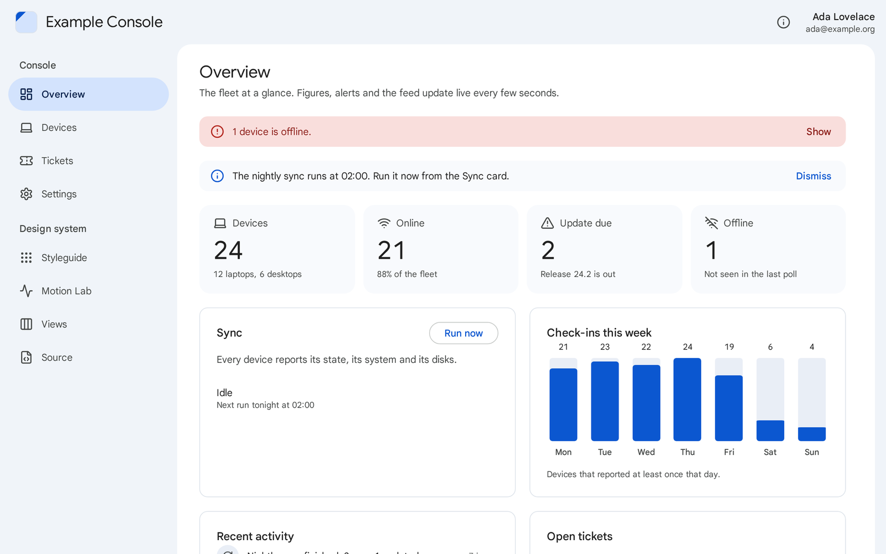</a><br>🖥️ <b>Reference app</b>: a device console built the way a project uses the system.</td>
<td width="50%"><a href="https://saschazesiger.github.io/Dashboard-Style/example/#/devices">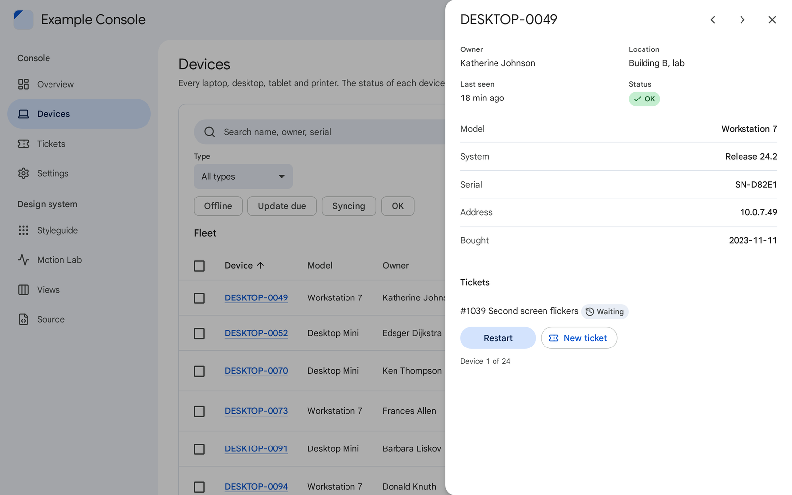</a><br>📋 <b>Tables and side sheets</b>: search, filter chips, sorting, bulk selection, details next to the list.</td>
</tr>
<tr>
<td><a href="https://saschazesiger.github.io/Dashboard-Style/styleguide/index.html">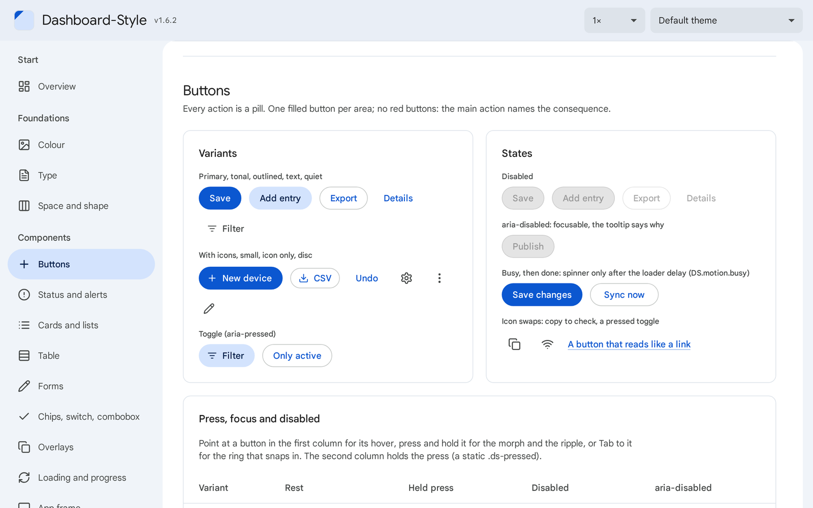</a><br>🧩 <b>Styleguide</b>: every component, token and icon, with a theme switcher.</td>
<td><a href="https://saschazesiger.github.io/Dashboard-Style/styleguide/motion.html">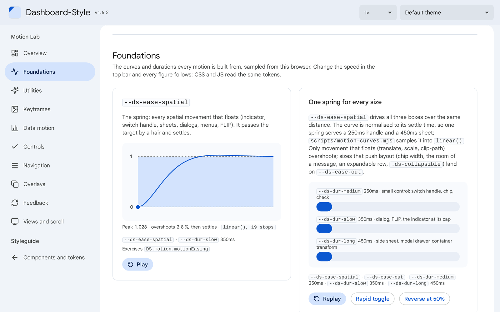</a><br>🎬 <b>Motion Lab</b>: every curve sampled from your browser, every choreography replayable.</td>
</tr>
<tr>
<td><a href="https://saschazesiger.github.io/Dashboard-Style/#choose">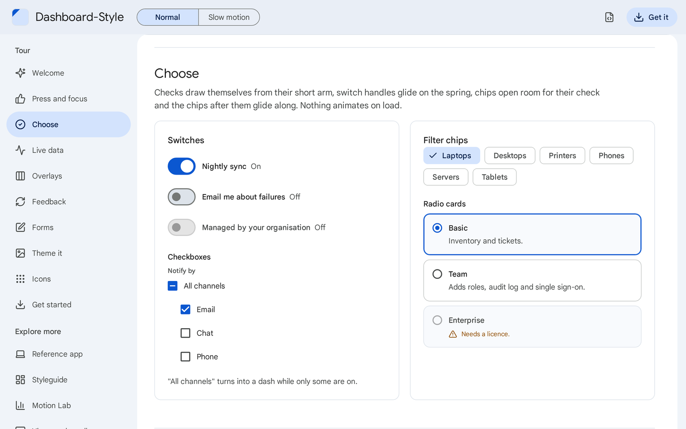</a><br>✅ <b>Controls</b>: checks that draw themselves, switches on a spring, chips that make room.</td>
<td><a href="https://saschazesiger.github.io/Dashboard-Style/#icons">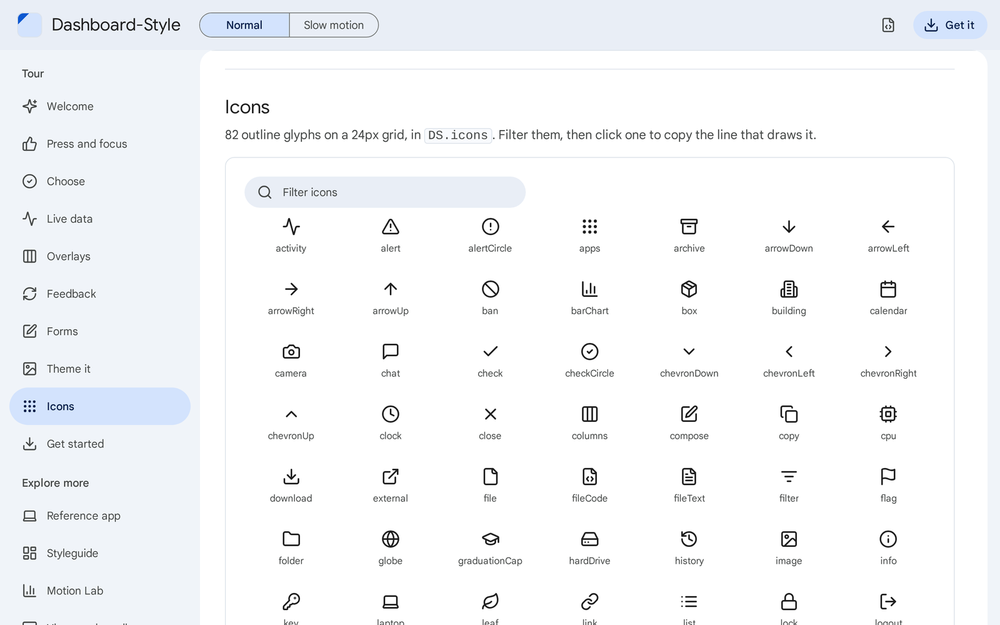</a><br>🖼️ <b>109 icons</b>: one outline set on a 24px grid, in <code>DS.icons</code>.</td>
</tr>
</table>

📱 **Phones included**: the drawer turns modal at 900px, forms drop to one column, fields keep 16px text.

<p>
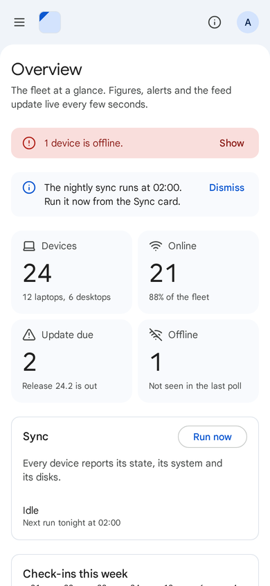
&nbsp;&nbsp;
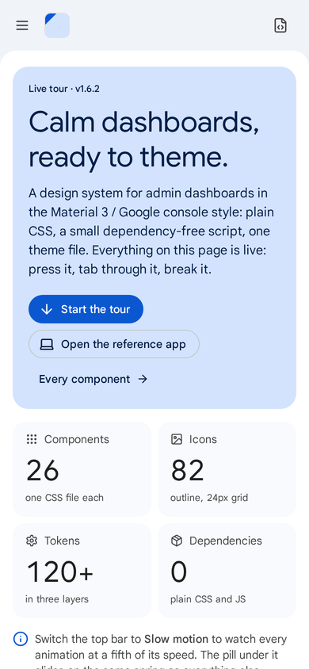
</p>

MIT licensed. The bundled Google Sans font is under the SIL Open Font License 1.1; the icon shapes come from Lucide
(ISC) and Feather (MIT), see [LICENSE](LICENSE). Light by default; dark, compact and high-contrast themes ship with it
([Theming](#-theming)).

## ⚡ Quick start

Copy `dist/` into your project (or use the CDN, see below) and write:

```html
<!doctype html>
<html lang="en" class="ds-theme ds-base">
<head>
  <meta charset="utf-8">
  <meta name="viewport" content="width=device-width, initial-scale=1">
  <title>Devices</title>
  <link rel="stylesheet" href="dist/fonts/fonts.css">
  <link rel="stylesheet" href="dist/ds.css">
</head>
<body>
  <div class="ds-content"><div class="ds-page">
    <header class="ds-page-head"><h1 class="ds-page-head__title">Devices</h1></header>
    <section class="ds-card">
      <h2 class="ds-card__title">Inventory</h2>
      <p class="ds-muted">128 devices, 3 need attention.</p>
      <button class="ds-btn ds-btn--primary" type="button">Add device</button>
    </section>
  </div></div>
  <script src="dist/ds.js"></script>
</body>
</html>
```

- 🎨 `ds-theme` turns the tokens on, `ds-base` (optional) styles the page itself: backdrop, body text, links, focus.
- 🧠 `ds.js` is only needed for the motion helpers, the sliding indicator, the DOM morph, the pointer ripple
  (`DS.ripple.attach(document)` once), the overlays (`DS.overlay`: dialogs, side sheets, the modal drawer, menus, the
  combobox list, tooltips and snackbars) and the icons (`window.DS`). Every component works without it, overlays then
  opened and closed by hand as [docs/components.md](docs/components.md) describes.
- 🖥️ For a whole app (navigation, tables with live data, overlays, forms, a project theme and project components),
  read the reference app in [`example/`](example/README.md): its README maps every pattern to its code.
- 🚀 The live tour in [`demo/`](demo/index.html) shows one working demo of every behaviour, wired as a project wires it.
- 🧩 Open [`styleguide/index.html`](styleguide/index.html) in a browser (works from disk) to see every component, the
  tokens and the icons, and to try a theme file. Its Motion Lab, [`styleguide/motion.html`](styleguide/motion.html),
  plots every curve as your browser plays it, lines up the durations and replays every choreography, with rapid
  toggles and reversals; the speed select in the top bar slows it all down to 0.1×.

## 📦 Install

**🔒 Vendor a copy (recommended).** The script copies `dist/` of the latest `main` into your project and writes
`VERSION` (with the exact commit) and `SHA256SUMS` next to it, so a test or CI step can prove nobody edited the copy.
To update, run it again.

```sh
curl -fsSLO https://raw.githubusercontent.com/saschazesiger/Dashboard-Style/main/scripts/vendor.sh
sh vendor.sh vendor/dashboard-style             # copy the latest main (or: vendor.sh <ref> <dest>)
sh vendor.sh --check vendor/dashboard-style     # verify (exit 1 if anything changed)
```

Windows PowerShell: `scripts/vendor.ps1` with the same arguments (`-From`, `-Check`). A nightly GitHub Actions
workflow that keeps the copy on `main` is in [`templates/`](templates/update-dashboard-style.yml).

**🌍 CDN.** jsDelivr serves the repository (`@main`, or a commit hash to pin):

```html
<link rel="stylesheet" href="https://cdn.jsdelivr.net/gh/saschazesiger/Dashboard-Style@main/dist/ds.css">
<link rel="stylesheet" href="https://cdn.jsdelivr.net/gh/saschazesiger/Dashboard-Style@main/dist/fonts/fonts.css">
<script src="https://cdn.jsdelivr.net/gh/saschazesiger/Dashboard-Style@main/dist/ds.js"></script>
```

**🧰 Bundlers.** `dist/css/` and `dist/js/` hold the single stylesheets and ES modules (with their `.d.ts` types);
import only what you need. Details, updates and integrity checks: [docs/install.md](docs/install.md).

**🔍 Checks.** `dist/tools/` runs without network or dependencies: `verify.mjs` (or `verify.sh`) checks a copy against
its `SHA256SUMS`, `check-theme.mjs` a theme file, `check-project.mjs` your code against the project rules
(deprecated and removed names from `dist/deprecations.json` included).

**⬆️ From 1.x to 2.0.** 2.0.0 removes the names deprecated in 1.x and changes a few defaults. Work through the
"Migration" table of [2.0.0 in the changelog](CHANGELOG.md#200), then run `tools/check-project.mjs`
([docs/install.md](docs/install.md), "Updating").

## 🎨 Theming

Load a theme after `ds.css` and override tokens on the same `.ds-theme` selector:

```css
.ds-theme {
  --ds-primary: #006a6a;
  --ds-accent: #cce8e7;
  --ds-on-accent: #002020;
  --ds-inverse-primary: #4cdada;
  --ds-font: 'Inter', system-ui, sans-serif;
}
```

[`themes/example.css`](themes/example.css) is a template listing every role. Guide: [docs/theming.md](docs/theming.md).
Shipped themes in `dist/themes/`: `dark.css` (for `prefers-color-scheme: dark`), `compact.css` and `contrast.css` (for
`prefers-contrast: more`). `node dist/tools/check-theme.mjs theme.css` checks a theme file.
Want to play first? The [**Theme it**](https://saschazesiger.github.io/Dashboard-Style/#theme) stop of the tour builds
a theme file from a few clicks and lets you copy it.

## 🧩 What's inside

| | |
|---|---|
| 🏗️ **Frame** | top bar (actions, search, title), navigation drawer (modal on phones, groups, counts, a rail) with a sliding pill, account capsule, avatars, a message for the whole app, segmented switch, tabs, steps, one scrolling content panel, a sign-in page |
| 🃏 **Content** | page head with breadcrumbs and a way back, cards (also interactive and selectable), tiles, row lists, key-value lists and facts, disclosures, a timeline, task lists, prose and code blocks, empty states |
| 🚦 **Status** | status chips, tags, badges, alerts, error lists, snackbars (with Undo), tooltips |
| 📊 **Data** | tables with sorting, selection and a bulk selection bar, expandable, stacked and full-page rows, a pinned first column, pagination, sideways scrollers; meters, columns and legends; progress (linear and round), loaders, skeletons |
| 📝 **Input** | buttons (busy and done faces, icon swaps), fields (input groups, counters, changed fields), selects, checkboxes, radio cards, switches (also locked), filter, action and input chips, combobox (also select-only), search, slider, a growing composer, file fields and drop zones, rows to reorder |
| 🪟 **Overlays** | dialogs (also full screen and as an action sheet, with built-in `confirm()`, `alert()` and `prompt()`), side sheets, menus, a save bar, through `DS.overlay` (focus, Escape, scroll lock, stacking, busy overlays that stay open) |
| 🌊 **Motion** | `DS.motion` (`flip`, `countUp`, `busy`, `transition`, `refresh`, `sortable`, `crossfade` ...), `DS.indicator`, `DS.dom` (`morphHtml`, `watchScrolled`, `scrollEdges`, `roving`, `progress` ...), `DS.ripple` with the action guard |
| 🖼️ **Icons** | 109 outline glyphs in `DS.icons` |
| 🎨 **Themes and tools** | dark, compact and contrast themes; `dist/tools/` checks a copy, a theme and a project; `tokens.json`, `deprecations.json` and TypeScript types |

Which component fits which need: the table at the top of [docs/components.md](docs/components.md).

## 📚 Documentation

| Topic | |
|---|---|
| 📦 [Install and update](docs/install.md) | vendoring, CDN, bundlers, fonts, verifying a copy, checking a project, language and locale |
| 🎚️ [Tokens](docs/tokens.md) | the three layers and every token (the motion scales in [Motion](docs/motion.md#tokens)) |
| 🎨 [Theming](docs/theming.md) | writing a project theme, component hooks |
| 🧩 [Components](docs/components.md) | which component for which need, copy-paste markup for every component |
| 🗺️ [Patterns](docs/patterns.md) | page types and flows (list, record, settings, create, delete with undo, bulk actions ...) built from the components |
| 🌊 [Motion](docs/motion.md) | principles, motion tokens, rules, the choreography of every component, interruption, keyframes and utilities, `DS.motion` (FLIP, `countUp`, `transition`), indicator, morph, ripple, overlays, recipes, view transitions, scroll-driven effects |
| 🖼️ [Icons](docs/icons.md) | the outline set and its helpers |
| 📐 [Rules](docs/rules.md) | the design rules the components follow, and the accessibility statement (WCAG 2.2 AA) |

## 🗂️ Files

```
dist/            what you ship (built, committed): ds.css, ds.js, ds.d.ts, css/ (with css/optional/, css/properties.css), js/, fonts/, themes/, tools/, tokens.json, LICENSE, SHA256SUMS
src/             sources: tokens.css, motion.css, base.css, components/*.css, optional/*.css, js/*.js, types/ (ds.d.ts, js/*.d.ts), deprecations.json, index.css (order)
fonts/           Google Sans (latin, latin-ext) with fonts.css and OFL.txt
themes/          example.css, the theme template; dark.css, compact.css, contrast.css, the shipped themes
demo/            the live tour: one page that demonstrates every behaviour (the start page on GitHub Pages)
example/         the reference app: a device console on top of dist/, as a project builds one (published on GitHub Pages)
styleguide/      living styleguide (open index.html; motion.html: the Motion Lab; views.html: view transitions and scrolling)
scripts/         build.mjs, motion-curves.mjs, vendor.sh, vendor.ps1, site.sh (assembles the GitHub Pages site); tools/: the sources of dist/tools/
templates/       update-dashboard-style.yml, a GitHub Actions workflow that keeps a copy on main
test/            node --test unit tests, no dependencies; test/browser/ Playwright tests (three engines)
docs/            the documentation above (docs/images/: the pictures of this README)
AGENTS.md        how to work on the system (CLAUDE.md points to it)
```

## 🌐 Browser support

Safari 16.4, Chrome and Edge 111, Firefox 128 (ESR) and later. Everything in `src/` may run in an embedded widget
on such a browser, so the CSS uses `:focus-visible`, `:has()`, `inset`, container queries, `color-mix()`,
`svh`/`dvh`, `<dialog>`, `inert`, `@layer`, `@property` and the individual `translate`/`scale`/`rotate` directly,
but no CSS nesting; the JS is ES2022.

Newer features are refinements only, behind a feature query where it matters, and each file names them under
"Progressive:" in its header with its fallback: `linear()`, `@starting-style`, `transition-behavior:
allow-discrete`, `popover`, anchor positioning, View Transitions, scroll-driven animations, `interpolate-size`,
`::details-content`, `overflow-clip-margin`, `sibling-index()`, `moveBefore()`, `scrollbar-gutter`,
`focus({ focusVisible: false })`, plus `text-wrap` and `scrollbar-color`. Older browsers get the same page without the refinement (a cubic curve instead of the spring,
a disclosure that toggles instead of gliding).

## 🛠️ Develop

Node 22 or later. The unit tests, the build and `npm run check` need nothing installed. The browser tests
(Chromium, Firefox and WebKit, through the one pinned devDependency `@playwright/test`) need `npm ci` and the
Playwright browsers once.

```sh
npm test          # guardrails: tokens, literals, motion, docs, dist up to date
npm run build     # rebuild dist/ after changing src/ or fonts/
npm run check     # tests and a check that dist/ matches src/, as CI does

npm ci                                                # once, for the browser tests only
npx playwright install --with-deps chromium firefox webkit   # when the pinned browsers are not cached
npm run test:browser                                  # motion, layout and screenshots in three engines
npm run test:browser:update                           # rewrite screenshots and timelines, then review the diff
```

How the browser tests work, the screenshot environment and the known-bug markers:
[test/browser/README.md](test/browser/README.md).

Change `src/`, run the build, commit `src/` and `dist/` together, note the change in [CHANGELOG.md](CHANGELOG.md).
`main` is always releasable: projects that use the nightly update workflow receive every push within a day,
whatever the version number says, so a rename keeps the old name working and only a later major version removes it.
The full checklist for components, tokens, icons and keyframes is in [AGENTS.md](AGENTS.md).

<div align="center">

Made with 💙 for calm dashboards · [MIT](LICENSE)

</div>
